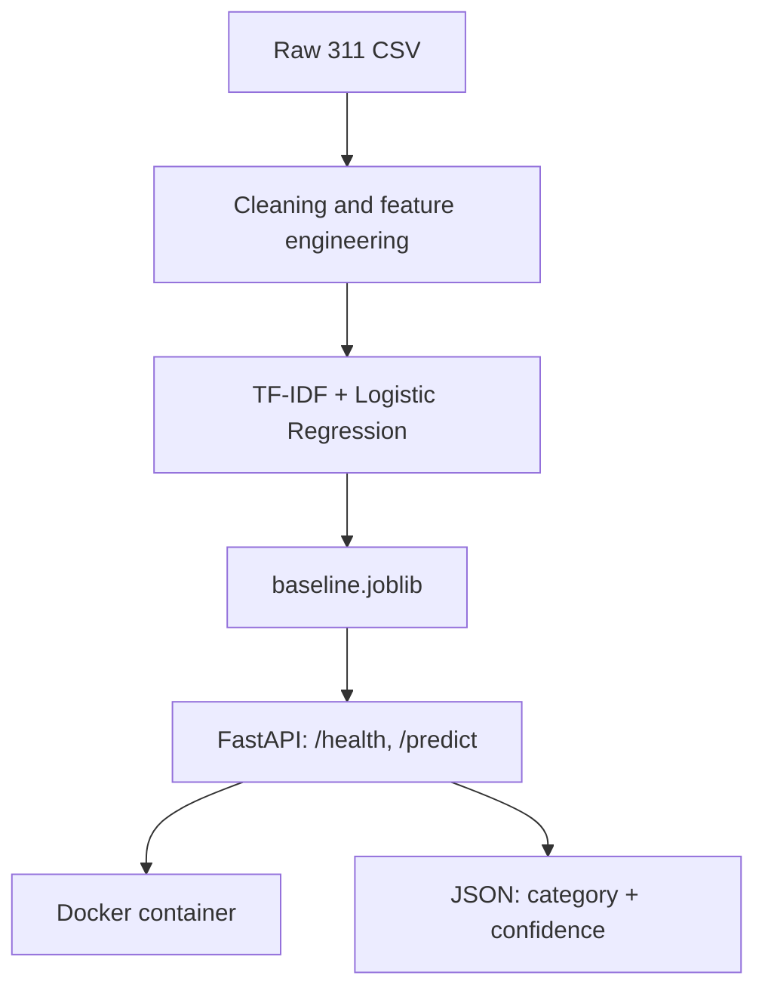

# TriageIQ

Intelligent complaint classification and prioritization for 311 service requests.

TriageIQ takes a free-text citizen request (for example, "pothole on Pratt St, damaged my tire") and routes it to the right city department with a confidence score. It covers the ML lifecycle from EDA to a deployable API.

## Problem
City 311 teams receive thousands of requests a month. Manual routing is slow and inconsistent. This project automates first-pass triage so staff can focus on exceptions.

## Dataset
- Synthetic 311 dataset: 20,000 requests, Jan 2024 to Dec 2025.
- Columns: category (5 classes), request_type (15), description (free text), agency, neighborhood, channel, priority, status, resolution_hours, latitude/longitude.
- The data is synthetic because the official dataset could not be downloaded. Descriptions are templated, so scores are higher than real data would give.
- The data is not committed. Place it at `data/311_requests.csv`.

## Architecture


Text version:

```
Raw 311 CSV
   -> Cleaning + feature engineering (text, time, neighborhood, channel)
   -> TF-IDF + Logistic Regression (scikit-learn)
   -> models/baseline.joblib
   -> FastAPI service (/health, /predict) in a Docker container
   -> JSON response: category + confidence
```

### Planned extensions
DistilBERT model, MLflow tracking, Evidently drift monitoring, clustering, and an LLM/RAG summarizer.

## Approach
1. **EDA** (`notebooks/01_eda.ipynb`): missing values, class balance, time patterns, resolution time by category.
2. **Baseline model** (`notebooks/02_baseline.ipynb`):
   - Time-based split: train before 2025-10-01, test after, to avoid leakage.
   - TF-IDF (unigrams and bigrams) with Logistic Regression and balanced class weights.
   - Features: description text, neighborhood, channel, hour, weekday.
   - Metric: macro-F1, because classes are imbalanced.
3. **Serving** (`src/api.py`): FastAPI service with `/health` and `/predict`.
4. **Containerization**: Dockerfile for the API.

## Results
| Model | Macro-F1 |
|---|---|
| TF-IDF + Logistic Regression (text only) | 0.xx |
| TF-IDF + Logistic Regression (text + features) | 0.xx |

Weakest class: (fill in). Scores are near-ceiling because the data is templated; I expect lower results on real data.

## How to run
```bash
python -m venv .venv
.venv\Scripts\activate          # Mac/Linux: source .venv/bin/activate
pip install -r requirements.txt
jupyter notebook                # run 01_eda, then 02_baseline (creates models/baseline.joblib)
uvicorn src.api:app --reload    # http://127.0.0.1:8000/docs
```

Example request:
```json
POST /predict
{"description": "pothole on Pratt St"}
```

Docker:
```bash
docker build -t triage-iq .
docker run -p 8000:8000 triage-iq
```

## Responsible AI notes
- Check performance by neighborhood for bias before any real use.
- Send low-confidence predictions to a human reviewer.
- Redact personal information (names, phone numbers) from descriptions before processing.

## Roadmap
- [ ] DistilBERT fine-tuning and comparison with the baseline
- [ ] MLflow experiment tracking and model registry
- [ ] Drift monitoring with Evidently
- [ ] Clustering and topic discovery on unlabeled requests
- [ ] LLM summarizer and RAG over city policy documents
- [ ] GitHub Actions CI/CD

## Tech stack
Python, pandas, scikit-learn, FastAPI, Docker, Jupyter
